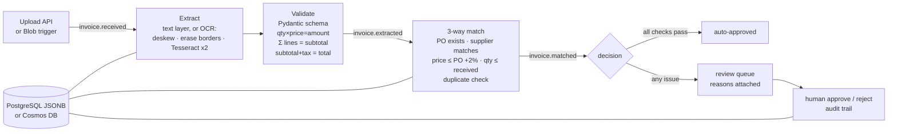

# invoice-extraction-pipeline

**Event-driven accounts-payable automation: invoice PDFs in, validated JSON and an approve-or-review decision out.** Digital PDFs are read from the text layer, scans go through OCR (deskew, table-border removal, Tesseract), and every invoice is checked against its purchase order and goods receipt (3-way match) before anything is approved. It runs as a FastAPI service on PostgreSQL, or serverless on Azure Functions with Blob Storage and Cosmos DB, deployed with Terraform.


> All invoices, suppliers and purchase orders are **synthetic** (`invoiceflow generate`). The data uses three invoice layouts, 25% of the PDFs are image-only "scans" (rotated, blurred, noisy, JPEG-compressed), and about 20% of invoices carry a planted problem. Samples are in [`samples/`](samples/).

## The problem

AP teams key in invoices by hand and catch billing errors by eye. Automation saves real time, but only if it **never approves a bad invoice**: an overbilled price, more units than were received, a PO that doesn't exist, or a duplicate submission. So the goal isn't 100% extraction. It is that anything the system can't fully verify goes to a person.

## Results

300 synthetic invoices through the full pipeline (event bus → extraction → 3-way match → store). Report: [`reports/eval_report.md`](reports/eval_report.md).

| Extraction | Digital PDFs (219) | Scanned PDFs, OCR (81) |
|---|---|---|
| Header fields (invoice #, supplier, PO, dates, total) | 100% | 100% |
| All line items exactly right (SKU, qty, unit price) | 100% | 49.4% |

| Decision | Result |
|---|---|
| **Bad invoices auto-approved** | **0** |
| Planted problems held for review | 55 of 55 (price over PO 8/8, qty over received 16/16, unknown PO 12/12, totals mismatch 7/7, duplicates 12/12) |
| OCR misreads caught by the arithmetic checks and sent to review | 30 of 30 |
| Straight-through processing (no human touch) | 71.3% |
| Clean invoices sent to review unnecessarily | 1 of 215 |
| Median processing time | 11.5 ms (text layer), 1.5 s (OCR) |

**The honest headline:** OCR reads table rows right only about half the time on these deliberately rough scans. The pipeline still never approves a misread invoice, because every line must satisfy `qty × price = amount` and the lines must add up to the subtotal. When they don't, a person looks at it. Better OCR would raise the straight-through rate; the safety comes from the validation either way. CI fails the build if a single bad invoice gets auto-approved.

## Architecture



| Requirement | Implementation |
|---|---|
| PDF/document processing | `pdfplumber` text layer, `pypdfium2` rendering, Tesseract OCR with deskew and table-border removal (`extract.py`) |
| Structured JSON output | Pydantic models with validators; optional LLM extractor using the same JSON schema (`llm_extract`) |
| Event-driven workflow | Topic-based bus: in-memory locally, `KafkaBroker` (confluent-kafka, works with Azure Event Hubs' Kafka endpoint) in production |
| Idempotency | Document SHA-256 is the primary key: re-uploads and redelivered events never double-process |
| Poison messages | A document that crashes extraction is parked for review instead of stopping the consumer |
| Relational storage | SQLAlchemy Core: SQLite locally, **PostgreSQL JSONB in CI** (service container) |
| Azure | `azure_function/function_app.py`: Blob trigger → extract + match → Cosmos DB output binding |
| Infrastructure as code | Terraform: Storage, Cosmos DB (serverless), Function App (managed identity), Key Vault references, App Insights |
| Testing | Unit tests (parser, validators, match rules), integration tests (bus, store, API, Azure handler, Postgres) and an end-to-end eval gate |

## Quickstart

```bash
git clone https://github.com/rakeshsaineni/invoice-extraction-pipeline && cd invoice-extraction-pipeline
sudo apt-get install -y tesseract-ocr        # macOS: brew install tesseract
python -m venv .venv && source .venv/bin/activate
make install
make data                                    # 300 invoices in data/
invoiceflow extract samples/scanned_INV-76510.pdf
make eval                                    # about 2 minutes (OCR is the slow part)
make serve                                   # POST /invoices, GET /review-queue, POST /invoices/{id}/review
```

```bash
curl -X POST "localhost:8000/invoices?filename=inv.pdf" -H "content-type: application/pdf" \
     --data-binary @samples/layout0_INV-66429.pdf
```

**Deploy to Azure:** `cd infra/terraform && terraform init && terraform apply -var subscription_id=...`, then publish `azure_function/` with `func azure functionapp publish <name>`. Secrets reach the function as Key Vault references through its managed identity, never as plain app settings.

## Design decisions

- **Validation beats accuracy.** I could chase OCR accuracy for weeks. Arithmetic cross-checks turn every OCR error into a review instead of a wrong payment, and that is what the business needs on day one.
- **Two OCR passes, keep the one that adds up.** Tesseract is run in two page-segmentation modes, and the reading whose line items reconcile is kept. The invoice's own arithmetic acts as the referee.
- **Deterministic first, LLM optional.** Label-tolerant patterns handle known layouts at about 11 ms per invoice for free. An LLM extractor (`llm_extract`) fills the same schema for unfamiliar layouts, and its output faces the same checks, so a model can't "balance" an invoice by inventing numbers.
- **The hash of the file is the identity.** It makes uploads, Kafka redelivery and Azure blob retries idempotent without any coordination.
- **Duplicates are checked twice:** byte-identical files by hash, and re-issued invoices by supplier + invoice number.

## Limitations and next steps

- Only the first page is read, and only three layouts are known. Multi-page invoices and an LLM or layout-model fallback (Azure AI Document Intelligence) are the next steps.
- OCR row accuracy (49%) could improve with OpenCV line detection or a table-structure model.
- Add a React review screen. My [eval-workbench](https://github.com/rakeshsaineni/eval-workbench) project shows the same human-in-the-loop pattern in TypeScript.
- Wire `KafkaBroker` into the API process with a consumer worker and dead-letter topic, and run the docker-compose stack in CI.

## Project layout

```
src/invoiceflow/  synth · extract (text/OCR/parse/validate) · match · broker · pipeline · store · api · evaluate · cli
azure_function/   Azure Functions app (blob trigger → Cosmos DB)
infra/terraform/  Azure resources
samples/          one PDF per layout plus one scan
tests/            14 tests (PostgreSQL test runs in CI)
```
